# How Bio-dash works

Flow diagrams for the whole suite, from the devices to the files on disk. GitHub renders the
diagrams below; elsewhere, paste a block into <https://mermaid.live>.

1. [The big picture](#1-the-big-picture) — devices, radios, workers, web apps, recordings
2. [Inside one dashboard](#2-inside-one-dashboard) — how a worker and its web app talk
3. [A device's life cycle](#3-a-devices-life-cycle) — scan, connect, record, reconnect
4. [Hydro-dash: the bottle protocol](#4-hydro-dash-the-bottle-protocol)
5. [Atmos: from any sensor format to tiles](#5-atmos-from-any-sensor-format-to-tiles)
6. [Starting and running everything](#6-starting-and-running-everything)
7. [Hydro-dash: which Bluetooth radio](#7-hydro-dash-which-bluetooth-radio) — the old-dongle catch
8. [Analysis: from recordings to one clock](#8-analysis-from-recordings-to-one-clock) — the sixth dashboard
9. [Radios on the Orin: what plugs in where](#9-radios-on-the-orin-what-plugs-in-where) — every adapter tried, and the boot catch

**Colour key** (same in every diagram):

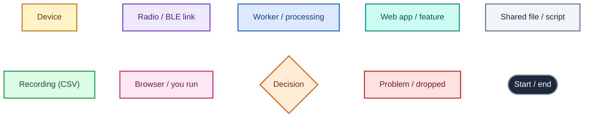

---

## 1. The big picture

Each device has its own dashboard: a **worker** that talks Bluetooth (or Wi-Fi) and records, and
a **web app** that serves the page. Omni runs both body sensors in one process.

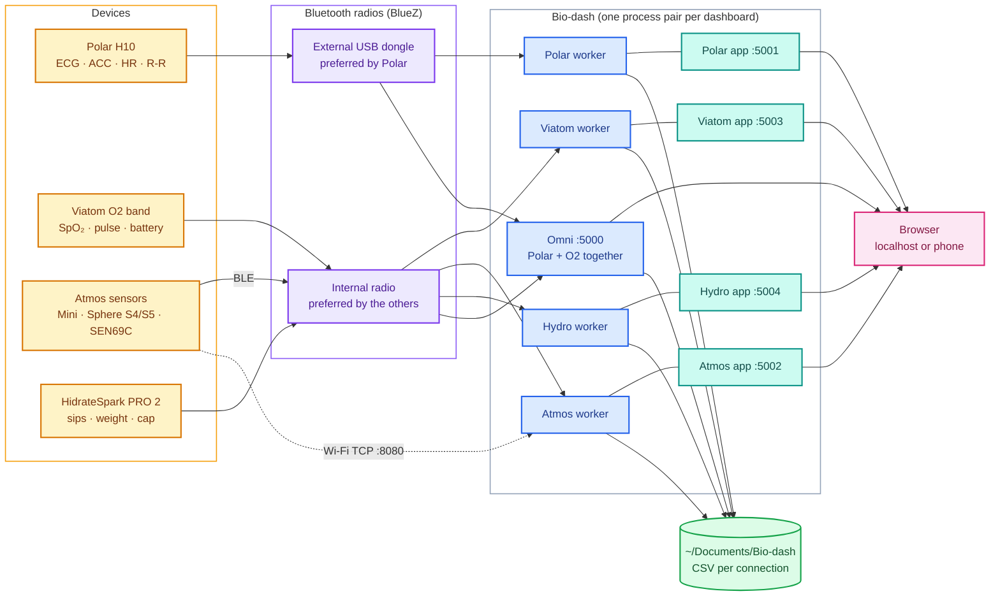

- **Radio routing:** each dashboard picks a radio by its *address* (stable across reboots) from
  `radio_config.json`, or automatically: Polar prefers the external dongle, the rest the internal radio.
- **Omni and the standalone Polar / Viatom dashboards are alternatives** — both would try to own
  the same devices (`biodash.py` won't install them together).

---

## 2. Inside one dashboard

The worker and the web app are separate processes that share a few small files, so either can
restart without taking the other down.

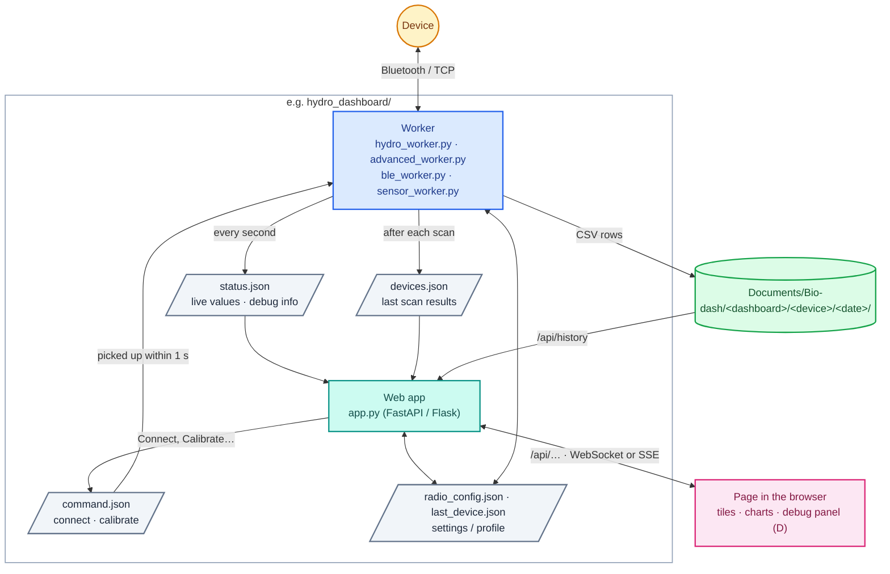

- **Live data:** Polar and Atmos push over a WebSocket, Viatom and Omni over Server-Sent Events,
  Hydro-dash polls (its data changes a few times an hour).
- **History:** tile trends and Hydro-dash's totals are read back from the CSV recordings, so they
  survive restarts.
- **Shared code** (identical copies in every dashboard): `bt_debug.py` (radios, auto-reconnect,
  recordings, shutdown/reboot, updates) and the page scripts `sidebar.js`, `tile_trends.js`, `reconnect.js`.

---

## 3. A device's life cycle

The same loop in every worker. Hydro-dash's connect step differs; see section 4.

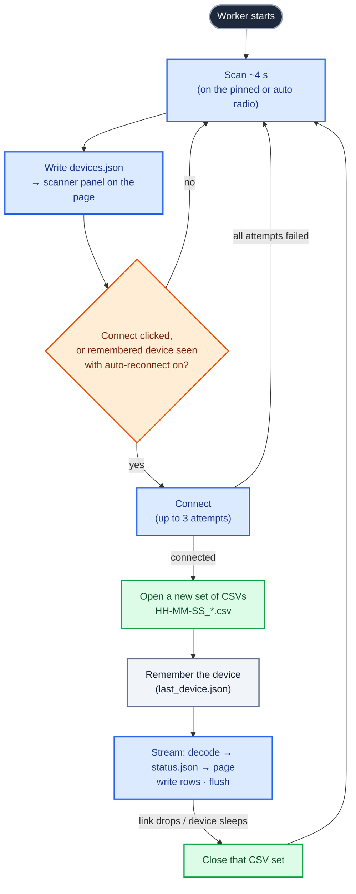

- **One CSV set per connection.** A dropout ends the set; the reconnect starts a new one in the
  same date folder. Timestamps are absolute, so sets line up.
- **Auto-reconnect** can be paused or forgotten from the reconnect bar on each page
  (`BIODASH_AUTORECONNECT=0` turns it off by default).

---

## 4. Hydro-dash: the bottle protocol

The PRO 2 sleeps, advertises only briefly after being moved, **changes its address each wake-up**,
and is dropped by BlueZ the moment scanning stops — hence the unusual connect step.

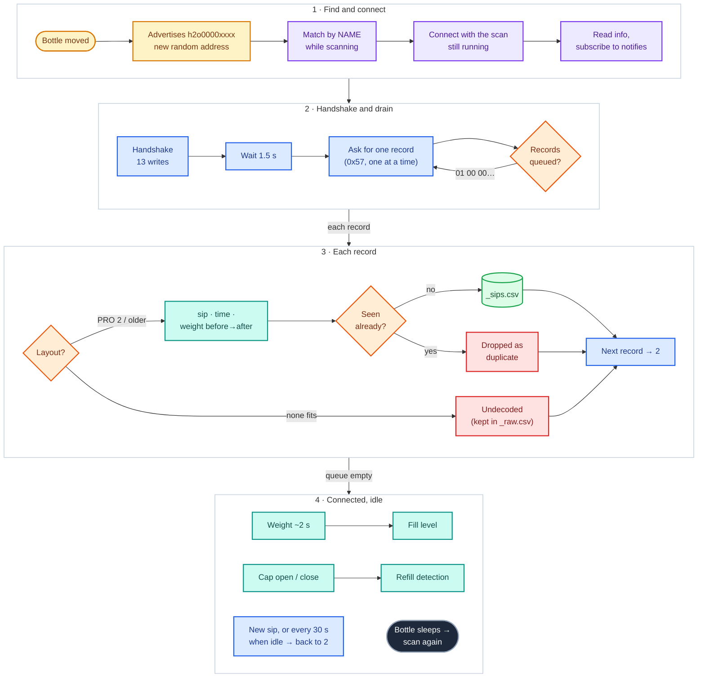

- **Totals, charts, "today"** are computed from `_sips.csv` across all sessions, so replayed sips
  land on the right day and nothing double-counts.
- **Everything raw** goes to `_raw.csv` (every notification, hex) — the basis for decoding new firmware.
- Protocol details and sources: `hydro_dashboard/PROTOCOL.md`.

---

## 5. Atmos: from any sensor format to tiles

One parser handles every Atmos board, over Bluetooth (Nordic UART) or Wi-Fi (TCP).

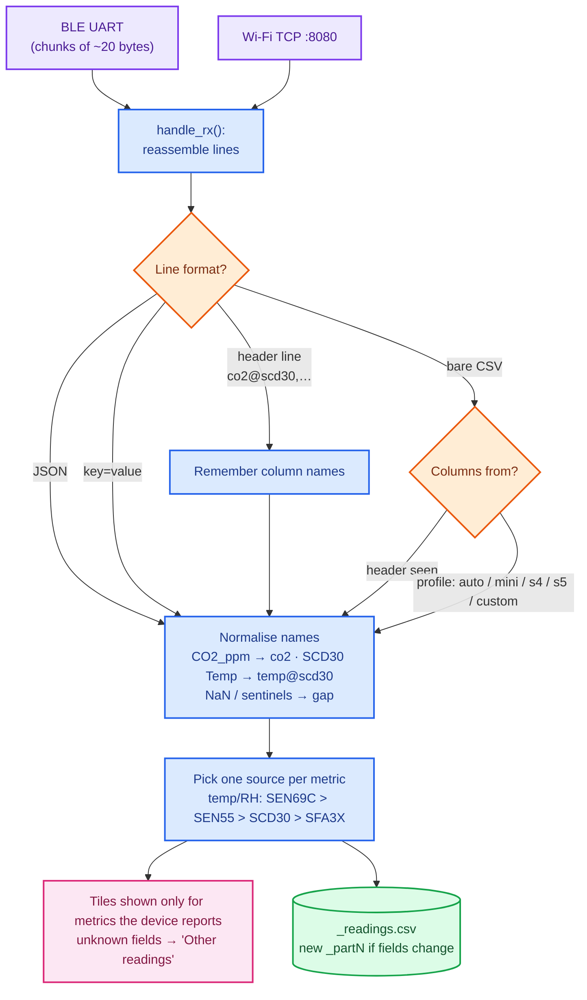

- The firmware for the S4 and SEN69C boards sends a **header line** first, so columns are mapped
  by name and no profile guessing is needed.

---

## 6. Starting and running everything

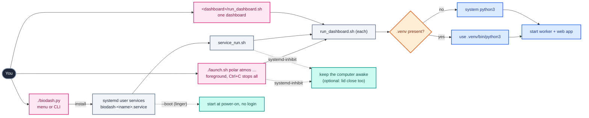

- **`./setup_env.sh`** creates the `.venv` once; everything else uses it automatically.
- **Service options** (`biodash.py`): keep awake, lid close, auto-reconnect, shutdown/reboot from
  other devices, start at boot.
- **On the page:** ☀ *Keep screen on* (localhost or HTTPS), 🐞 debug panel with the System card
  (shutdown / reboot), header links between dashboards.

---

## 7. Hydro-dash: which Bluetooth radio

The bottle is the one device in the suite that is picky about the radio. It has to be **heard**
(it only advertises for a few seconds after it's moved) and it has to get through **reading its
service list**, and the two radios a laptop usually has each fail a different half.

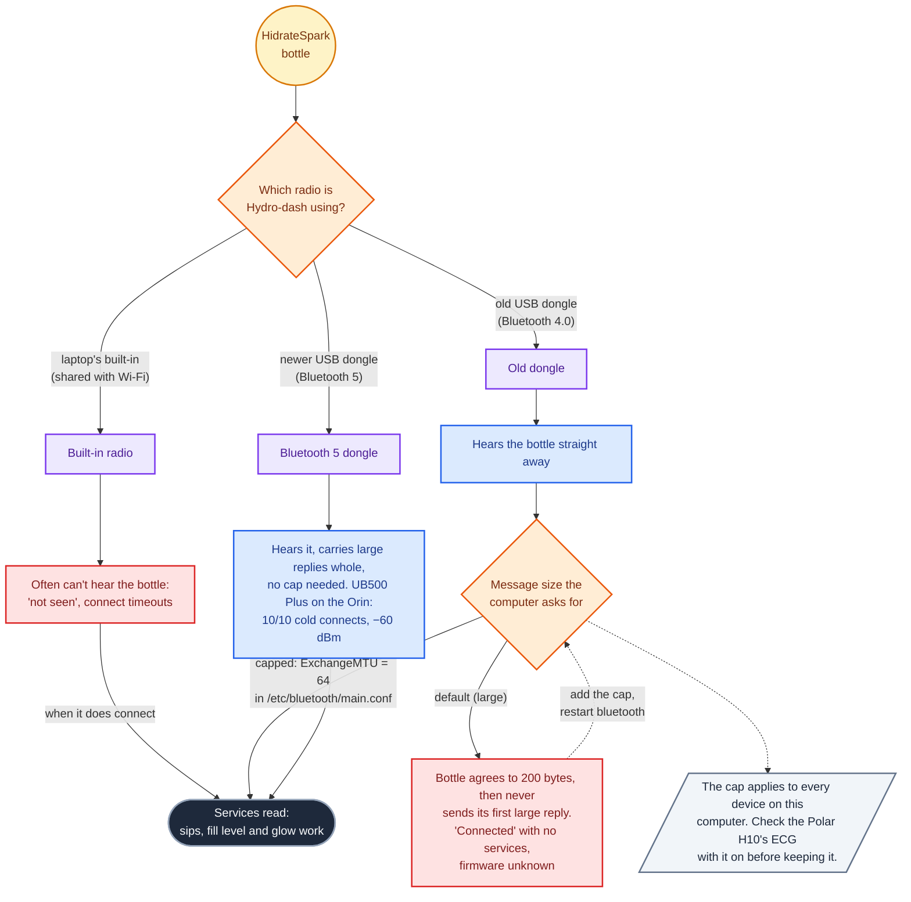

- **What it looks like:** the scanner finds the bottle, the page says connected, and nothing else
  arrives: no firmware version, no battery, no sips.
- **Why:** an old dongle sends 27 bytes per radio packet, so a large reply has to be cut into many
  pieces, and this bottle doesn't send it at all. With small messages every reply fits.
- **The bottle's address changes** from time to time. Each change makes the computer read the
  service list afresh, so this can appear on a setup that worked earlier the same day.
- **Choosing the radio:** debug panel (D) → Bluetooth Radio. The choice is saved by the radio's
  address, so it survives reboots (when hci numbers shuffle) and upgrades. Without a choice,
  Hydro-dash prefers a built-in radio; on boards whose USB ports don't say which radios are built in
  (the Orin Nano dev kit), that falls back to whichever radio is hci0.
- Step by step, with the commands: `hydro_dashboard/TROUBLESHOOTING.md`, sections 11 to 15.
- Every adapter tried so far, and why it did or didn't work: [section 9](#9-radios-on-the-orin-what-plugs-in-where).

---

## 8. Analysis: from recordings to one clock

The analysis dashboard (port 5005) has no worker and no radio: it reads the CSV recordings the other
dashboards wrote, so it runs anywhere those files are.

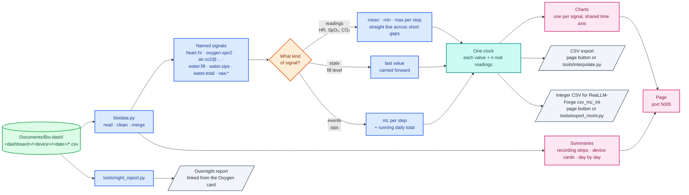

- **Nothing is changed on disk:** the dashboard and the tool only read the recordings (exports and
  reports are written to their own `Exports/` and `Reports/` folders).
- **Signals are merged across dashboards:** heart rate recorded by Polar-dash in the day and by
  Omni at night is one signal.
- **Estimates are marked:** every value carries `n`, the number of real readings behind it;
  0 means interpolated, carried forward, or "no sip in this step". Charts draw those dashed.
- **The ReaLLM-Forge export** (`analysis_dashboard/mcint.py`) writes the same table as whole numbers:
  a fixed scale and range per signal, `minute_of_day` / `second` for the time, and one value below
  each range (`-1`) for "no reading", because `csv_mc_int` allows no blank cells.

### Just the ECG (`tools/export_ecg.py`), step by step

The raw file keeps every sample as recorded; the 200 Hz file is resampled stretch by stretch and
never across a gap. With `--with-acc` the accelerometer (`_acc.csv`, X/Y/Z mg, 200 Hz) goes through
the same steps 1-3 on its own clock, is interpolated at each 200 Hz ECG row's time and added as
`ACC_X_mg,ACC_Y_mg,ACC_Z_mg`; a row with no unbroken motion either side ends the stretch there.

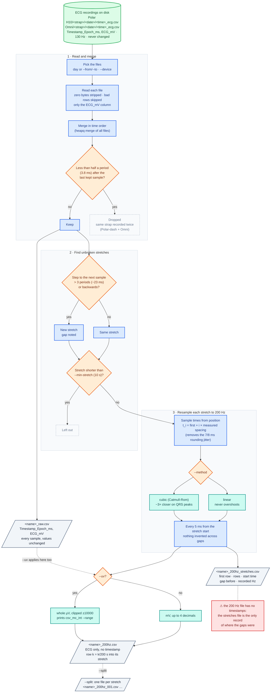

### The ReaLLM-Forge export, step by step

Everything happens when you export; the recordings are never changed. Red notes are the things to
know before training on it (`--max-gap 0 --hold 0 --real-flags` keeps it to real readings).

```mermaid
flowchart TB
    R[("Recordings on disk<br/>&lt;dashboard&gt;/&lt;device&gt;/&lt;date&gt;/*.csv<br/>never changed")]

    subgraph S1["1 · Read: load_signals"]
        direction TB
        A1["Clean<br/>zero bytes stripped · bad rows skipped<br/>timestamps → ms"]
        A2{"Sane range?<br/>HR 25–230 · RR 300–2000<br/>SpO₂ 50–100 · sip 1–2000 mL"}
        A3["Merge dashboards<br/>Polar + Omni = one heart rate<br/>one value per timestamp"]
        A4["Derived signals<br/>HR = 60000/RR (Omni)<br/>RMSSD per minute (skip &gt;20 % jumps)<br/>sips de-duplicated (±10 mL, 2 s) + daily total"]
        A1 --> A2
        A2 -->|yes| A3 --> A4
        A2 -->|no| X1["dropped"]
    end

    subgraph S2["2 · One clock: resample"]
        direction TB
        K{"Kind of signal<br/>(one value per --step)"}
        M["Readings<br/>mean of the step<br/>empty step: straight line<br/>if gap ≤ --max-gap (60 s)"]
        H["Levels (bottle fill)<br/>last value carried<br/>up to 30 min"]
        E["Sips<br/>mL per step · 0 while recording<br/>daily total held to midnight"]
        K --> M & H & E
    end

    subgraph S3["3 · Integers: mcint.build"]
        direction TB
        B1["Scale · round · clip to a fixed range<br/>temp_c_x10 −400…850, hr_bpm 0…250 …"]
        B2["Hold readings across gaps<br/>≤ --hold (2 min)"]
        B3{"Still empty?"}
        B4["−1  (one below the range)<br/>or --missing drop: row left out"]
        B5["minute_of_day (+ second)<br/>rows with no device at all left out"]
        B1 --> B2 --> B3
        B3 -->|yes| B4 --> B5
        B3 -->|no| B5
    end

    OUT[/"Export folder<br/>&lt;name&gt;.csv · .columns.json · .prepare.sh"/]

    subgraph S4["4 · Forge: get_dataset.sh"]
        direction TB
        F1["token = value − int_min<br/>one vocabulary per column"]
        F2["split by row order<br/>first 90 % train · last 10 % val"]
        F1 --> F2
    end

    BIN[("train.bin · val.bin · meta.pkl<br/>per column + manifest.json")]

    R --> A1
    A4 --> K
    M & H & E --> B1
    B5 --> OUT --> F1
    F2 --> BIN

    W1["⚠ up to ~3 min of each gap is made up<br/>(60 s line + 2 min hold) · --real-flags marks it<br/>--max-gap 0 --hold 0 for real data only"]
    W2["⚠ averaging hides beat-to-beat R-R<br/>at 10 s steps · use 1 s or hrv_rmssd_ms"]
    W3["⚠ time jumps where rows are left out<br/>no date column · DST repeats/skips an hour"]
    M -.- W1
    B2 -.- W1
    M -.- W2
    B5 -.- W3

    classDef store fill:#DCFCE7,stroke:#16A34A,color:#14532D,stroke-width:2px
    classDef worker fill:#DBEAFE,stroke:#2563EB,color:#1E3A8A,stroke-width:2px
    classDef decision fill:#FFEDD5,stroke:#EA580C,color:#7C2D12,stroke-width:2px
    classDef app fill:#CCFBF1,stroke:#0D9488,color:#134E4A,stroke-width:2px
    classDef file fill:#F1F5F9,stroke:#64748B,color:#1E293B,stroke-width:2px
    classDef warn fill:#FEE2E2,stroke:#DC2626,color:#7F1D1D,stroke-width:2px
    classDef gone fill:#F8FAFC,stroke:#94A3B8,color:#64748B,stroke-dasharray:4 3
    class R,BIN store
    class A1,A3,A4,M,H,E,B2,B5,F1,F2 worker
    class A2,K,B3 decision
    class B1,B4 app
    class OUT file
    class W1,W2,W3 warn
    class X1 gone
    style S1 fill:#F8FAFC,stroke:#CBD5E1
    style S2 fill:#F8FAFC,stroke:#CBD5E1
    style S3 fill:#F8FAFC,stroke:#CBD5E1
    style S4 fill:#F8FAFC,stroke:#CBD5E1
```

---

## 9. Radios on the Orin: what plugs in where

Every Bluetooth device gets its own radio (one radio streaming a busy device, like the Polar's ECG,
can starve the others). On the Jetson Orin Nano that's four radios for four devices:

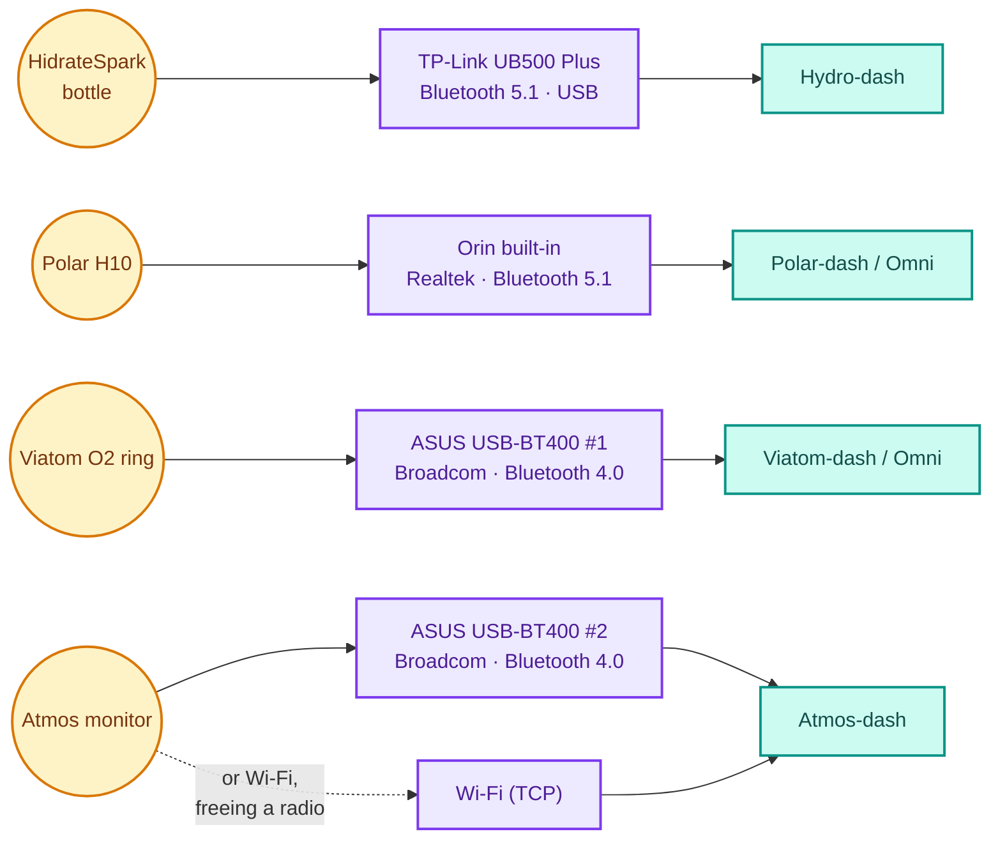

- **The bottle goes on the UB500 Plus.** It's the one device that needs a Bluetooth 5 radio
  (section 7). The O2 ring and the Atmos send small, slow packets that a 4.0 dongle handles fine.
- **The Polar gets a modern radio to itself** because its ECG is the busiest stream.
- **Each dashboard pins its radio by address** in its debug panel (D) → Bluetooth Radio
  (saved in `radio_config.json`, carried across upgrades). The hci numbers shuffle whenever
  dongles are added or the Orin boots, and the address is what stays put.

### The boot catch: what's plugged in at power-on

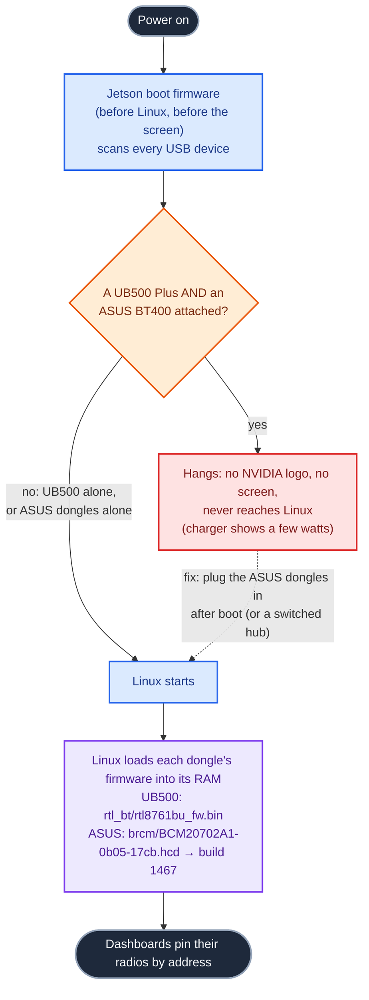

- **Not power:** two ASUS dongles together boot fine, and all four dongles add about 1 W once
  running (7–8 W total, no over-current messages). It's that particular pair at power-on.
- **The dongles' firmware can't fix it.** Neither chip has flash for its firmware: they run what's
  built into the chip, and Linux uploads the improved firmware into their RAM at every power-up,
  after the boot firmware has already met them.
- The Orin's boot firmware here was L4T 36.5.2, the newest of the JetPack 6 line (August 2026).

### Every adapter tried, and why it did or didn't work

| Adapter | Chip · USB ID | Bluetooth | Firmware | With the bottle | Notes |
|---|---|---|---|---|---|
| **TP-Link UB500 Plus** | Realtek RTL8761BU · `2357:0604` (same ID as the plain UB500) | reports 5.1 (box says 5.3) | `rtl_bt/rtl8761bu_fw.bin` + `_config.bin`, loaded by the kernel itself on JetPack 6 (kernel 5.15); no `btusb new_id` needed | ✅ **Works.** 10 of 10 cold connects with all 5 HidrateSpark characteristics; heard 8 times in 25 s at −60 dBm; Hydro-dash picked it by itself after a reboot; no `ExchangeMTU` cap | Antenna plugs in with an **MHF4** connector (the small one, not U.FL): use an MHF4-to-SMA pigtail to move it outside a case |
| **ASUS USB-BT400** | Broadcom BCM20702A1 · `0b05:17cb` | 4.0 | built-in "build 0000"; Linux needs `brcm/BCM20702A1-0b05-17cb.hcd` to bring it to **build 1467** (TROUBLESHOOTING 15) | ⚠ **Hears it instantly, then "connected, no services"**: 4.0 sends 27 bytes per packet and the bottle never sends its first large reply. Works only with `ExchangeMTU = 64`, which affects every device | Fine for the O2 ring and Atmos (small packets). **Stops the Orin booting** if attached together with a UB500 Plus at power-on (above) |
| **Orin Nano built-in** | Realtek 8822-series combo card, Realtek's own `rtk_btusb` driver | 5.1 | built in | not tried with the bottle this round | Its USB port doesn't say it's built in, so the debug panel shows no internal/external badge |
| **Laptop built-in** (FW13) | combo card shared with Wi-Fi | 5.x | built in | ❌ **Often doesn't hear it**: the bottle only advertises for a few seconds after it moves, and the shared antenna misses those bursts | TROUBLESHOOTING 11 |

**Powering the Orin:** a 12 V USB-C "trigger" board works only with chargers that offer 12 V,
which USB Power Delivery doesn't require. Any charger over 45 W must offer 20 V, the Orin's normal
input, so a 20 V trigger with a 65 W charger is the dependable choice.
